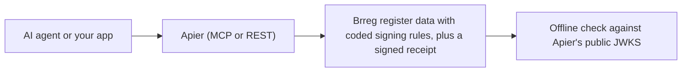

# Apier examples: Norwegian company verification and signing authority from Brreg, for AI agents

[](https://github.com/apier-no/apier-quickstart/actions/workflows/sandbox-smoke.yml)
[](./LICENSE)

[Apier](https://apier.no) gives AI agents machine-verifiable Norwegian company authority. For a 9-digit organisasjonsnummer it returns company verification (registration status, bankruptcy and liquidation flags, VAT registration, registered roles such as daglig leder and the board) and the company's signing authority, signaturrett and prokura, as Brønnøysundregistrene (Brreg) hold it in Enhetsregisteret and Fullmakttjenesten. Each answer carries its source and retrieval time, and you can ask for a signed receipt. It is used in KYB flows where an agent onboards, pays or contracts with a Norwegian company, over REST or MCP.

This repository holds runnable examples in curl, TypeScript, Python and Go. The Verify and Authority examples need no key and no account.

## Try it in 30 seconds (no key)

The public sandbox answers for the test company `999999999`:

```bash
curl -s https://www.apier.no/api/v1/sandbox/public/company/999999999/authority
```

Response from 2026-11-25, trimmed (other fields omitted):

```json
{
  "success": true,
  "data": {
    "org_number": "999999999",
    "name": "Apier Public Sandbox AS",
    "entity_type": "AS",
    "classification": "sole",
    "summary": "Én rolle kan signere alene for selskapet.",
    "combinations": [
      {
        "kombinasjons_id": "SANDBOX-KOMB-DAGL-ALENE",
        "description": "Daglig leder signerer alene.",
        "role_codes": ["DAGL"]
      }
    ],
    "signaturrett_holders": [{ "role": "DAGL", "name": "Ola Nordmann" }],
    "prokura_holders": [],
    "source": "brreg.fullmakt",
    "rule_set": "no.brreg.signatur.v1"
  },
  "_meta": { "is_sandbox": true, "source": "apier.no" }
}
```

Sandbox data is fictional. The public sandbox allows 100 requests per hour per IP address.

## How it fits together



## Examples

Every example prints the JSON response and exits non-zero on an HTTP error or a missing field.

| Step | curl | TypeScript | Python | Go |
|---|---|---|---|---|
| Verify | [`verify.sh`](./examples/curl/verify.sh) | [`verify.mjs`](./examples/typescript/verify.mjs) | [`verify.py`](./examples/python/verify.py) | [`main.go`](./examples/go/main.go) `verify` |
| Authority | [`authority.sh`](./examples/curl/authority.sh) | [`authority.mjs`](./examples/typescript/authority.mjs) | [`authority.py`](./examples/python/authority.py) | [`main.go`](./examples/go/main.go) `authority` |
| Proof | [`proof.sh`](./examples/curl/proof.sh) | [`proof.mjs`](./examples/typescript/proof.mjs) | [`proof.py`](./examples/python/proof.py) | [`main.go`](./examples/go/main.go) `proof` |

Run them from the repository root:

```bash
bash examples/curl/verify.sh
node examples/typescript/authority.mjs
python examples/python/proof.py
(cd examples/go && go run . verify)
```

Requirements: curl 7.76 or newer and bash; Node 20 or newer; Python 3.9 or newer; Go 1.21 or newer. None of the examples has a dependency outside the language's standard library.

The TypeScript examples are `.mjs` files with JSDoc types and `// @ts-check`. They pass the TypeScript compiler's strict check (`tsc --checkJs --strict`) and run on Node 20 with no build step.

### Verify

`GET /api/v1/sandbox/public/company/999999999/verify`. No key. Returns `verification_status` (`pass`, `fail` or `unknown`) and the signals behind it: whether the company is active, not bankrupt, not under dissolution, and has a registered signing authority.

In production the path is `GET /api/v1/company/{org}/verify` with an API key.

### Authority

`GET /api/v1/sandbox/public/company/999999999/authority`. No key. Returns the coded signing rules: a `classification`, the signing `combinations` as role codes, and the holders of signaturrett and prokura.

In production the path is `GET /api/v1/company/{org}/authority` with an API key.

### Proof

Adding `?certificate=true` to a Verify or Authority call wraps the answer in a certificate with a detached JWS signature. The public sandbox does not sign, so there is no proof call that works with no `Authorization` header at all. The proof examples do one of two things.

- **Without `APIER_API_KEY`** they call the bearer sandbox: `GET /api/v1/sandbox/company/818000006/authority?certificate=true`. The bearer is `apier_sandbox_test_<suffix>` with a suffix the example invents. It needs no signup. The certificate is signed with the sandbox key (Ed25519), whose public half is at `https://www.apier.no/.well-known/sandbox-jwks.json`. That key is public on purpose, so a sandbox certificate proves nothing about Apier. Use it to rehearse verification code.
- **With `APIER_API_KEY` and `APIER_ORG_NUMBER` set** they call production: `GET /api/v1/company/{org}/authority?certificate=true`. This needs a real key and each call is charged; see the [pricing page](https://www.apier.no/pricing). Production certificates are signed with RS256 and verify against `https://www.apier.no/.well-known/jwks.json`.

How to verify a certificate offline: https://www.apier.no/docs/guides/verify-certificate

Check the certificate offline: [apier-no/apier-receipt-verify](https://github.com/apier-no/apier-receipt-verify)

## Raw Brreg vs Apier

[`compare/README.md`](./compare/README.md) shows what Brreg's open APIs return for a real company with prokura and joint signing, what a developer builds on top of them, and what the Apier Authority response returns.

## Configuration

| Variable | Used by | Default |
|---|---|---|
| `APIER_BASE_URL` | all examples | `https://www.apier.no` |
| `APIER_API_KEY` | proof examples, production path | unset |
| `APIER_ORG_NUMBER` | proof examples, production path | unset |

`APIER_BASE_URL` must be an `https://` URL, or `http://localhost` / `http://127.0.0.1` for local development. The examples reject anything else, so a key is never sent to an untrusted host.

A real API key has the form `apr_<tier>_…`. https://www.apier.no/docs/authentication explains how to get one. `apier.no` redirects to `www.apier.no` and curl drops the `Authorization` header across that redirect, so send keyed calls to `www.apier.no`.

## MCP

The same data is available to MCP clients at `https://www.apier.no/api/mcp`. Setup for Claude, Cursor, VS Code and other clients is in [apier-no/apier-mcp](https://github.com/apier-no/apier-mcp) and at https://www.apier.no/docs/mcp.

## When not to use Apier

- Apier returns the register's own coding of signing rules, uninterpreted. It gives no yes or no on whether a person may sign for a given action. Your application applies the rules.
- It is not AML, PEP or sanctions screening.
- It is not legal advice.
- Sandbox data is fictional. A sandbox answer says nothing about a real company.

## Other endpoints

**Altinn 2 to Altinn 3 lookup.** `GET /api/v1/tools/altinn-migration` maps Altinn 2 service codes to their Altinn 3 replacements. No key. Filter to one entry with `?altinn2_code=A0208`.

```bash
curl -s https://www.apier.no/api/v1/tools/altinn-migration
node examples/altinn-migration.mjs
python examples/altinn-migration.py
```

## Links

- Apier: https://apier.no
- Docs: https://www.apier.no/docs
- MCP docs: https://www.apier.no/docs/mcp
- Pricing: https://www.apier.no/pricing
- Sandbox test data: https://www.apier.no/api/v1/sandbox/fixtures

## Security

Found a vulnerability? See [SECURITY.md](./SECURITY.md).

## License

MIT. See [LICENSE](./LICENSE).
